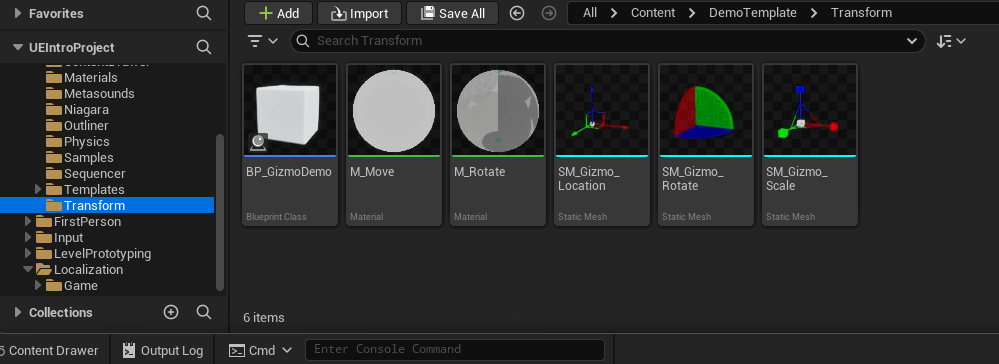
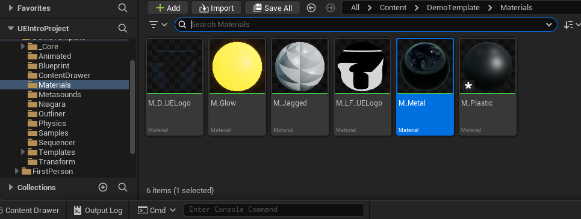
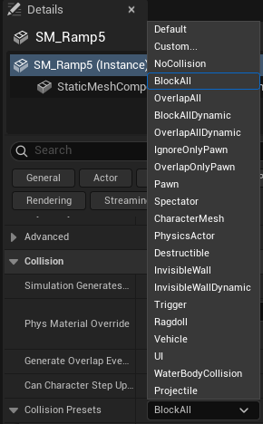
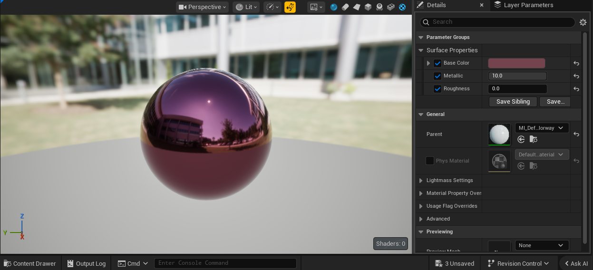

# Entry 1
##### 11/9/26

### Content
The tool I decided to learn for the rest of the year is **Unreal Engine** because I really want to make a **3D** game so I just chose the best one for the job.  
I mainly tinkered with it in the **tutorial** where it had you _add objects_ using the content drawer and _change properties_ using the details panel to see what happens.  

Adding objects:  

Changing materials:  

Using the details panel to change collision settings:  

I followed the [documentation](https://dev.epicgames.com/documentation/unreal-engine/unreal-engine-5-9-documentation?lang=en-US) made by _Epic Games_ as well.  

Other than using Unreal Engine's standard **blueprints**, I also decided to learn **C++** on Mondays via [codecademy](https://www.codecademy.com/enrolled/courses/learn-c-plus-plus) as I can't pull up Unreal Engine on my school Chromebook, so I'd have enough time to study C++ a little.

This will be helpful later on since C++ is the _primary_ coding language used in Unreal Engine.

Everything that I've learned is in my [learning log](https://github.com/williaml4292/apcsa-freedom-project/blob/main/tool/learning-log.md).  

Ultimately, using Unreal Engine, I decided to make a **3D RPG** as I love fantasy.  

Some other tools and projects that I've considered are using [ml5.js](https://ml5js.org/) to make an **AI** to search online for answers to a prompt and using [unity](https://unity.com/) to make a **2D** game.  

### Engineering Design Process (EDP)
I am currently in the _first stage of the Engineering Design Process_, which is to _define the problem_ (what I'm going to make). I've determined that I want to make a 3D RPG using Unreal Engine, but I still have to _research the problem_ (figure out **how** I'm going to make it). To do this, I plan on _finishing the **tutorial**_ on Unreal Engine, find _tutorials for **blueprints**_ and _**creating** objects_, then learning more as needed.
### Skills
Two skills that I've developed thus far are **how to learn** and having a**growth mindset**.
#### How to Learn
While I was going through the tutorial on Unreal Engine, I would frequently change things.  
For instance, when I was on the brief overview of **blueprints**, I had the option of just _skipping a puzzle_ given to me, but I decided to try it out and solve it, when I didn't even know how blueprints worked yet.  
I ended up trying and failing for around 45 minutes before I found out how it worked: **blueprints** need to be specifically enabled for an object in the details panel in order for it to apply.  

I also tried changing the properties of a ball object, specifically its color, how metallic it is, and its roughness.  

I found out that _metallic_ just means how well light reflects on the object and _roughness_ is how well other objects reflect on it (at 0, you can see what is currently facing the object).  
#### Growth Mindset
**Downloading** Unreal Engine and making it run was, _unexpectedly_, the biggest challenge that I've faced so far.  
When I finally decided to pick Unreal Engine, I just searched online how to download it.  
I found out that when downloading the _Epic Games Launcher_, you also get an _additional tab for downloading Unreal Engine_.  
However, when I tried it, the download button remained **grayed** out for me.  
I thought that I might have to do some other things before being able to use it, so I also [linked my github account](https://www.unrealengine.com/ue-on-github).  
After doing this, though, I still wasn't able to download Unreal.  
I then proceeded to shut down my computer several times among other things before finally finding a fix for this in the comments section of a [video](https://www.youtube.com/watch?v=rldy9yY0yDU).  
The video itself didn't have the fix for my problem, but the comments section did, and it worked.  
As it turns out, you **need** to download _Twinmotion_, Unreal Engine's _visualization tool_ **before** downloading Unreal.  
I don't really know why this is the case; usually, it should be the _other way around_: download Unreal before Twinmotion.  

[Next](entry02.md)

[Home](../README.md)
